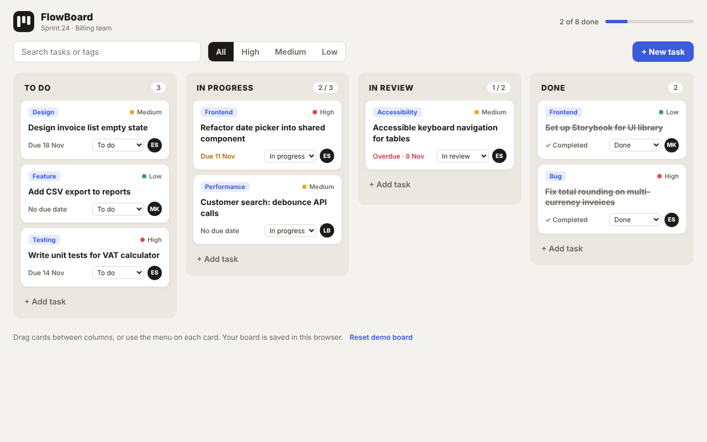

# FlowBoard

Drag-and-drop Kanban board for planning team work, saved in the browser.



**Live demo:** _add your Vercel link here after deploying_

## Features

- **Drag and drop** cards between and within columns, with a drop indicator showing where the card will land.
- **Keyboard and mobile friendly**: every card also has a "Move to" menu, since touch screens don't support HTML5 drag and drop.
- **Work-in-progress limits**: columns warn when they hold more tasks than their limit.
- **Create, edit and delete** tasks in a dialog (title, tag, priority, status, due date, assignee).
- **Due date status**: due soon and overdue cards are highlighted.
- **Search and priority filters**, plus a sprint progress bar.
- **State managed with `useReducer`** and saved to `localStorage`.

## Tech stack

- [React 18](https://react.dev) with function components and hooks
- [TypeScript](https://www.typescriptlang.org) in strict mode
- [Vite](https://vitejs.dev) for development and builds
- Plain CSS with custom properties (no UI framework)
- No backend: everything runs in the browser

## Getting started

You need [Node.js](https://nodejs.org) 18 or newer.

```bash
git clone https://github.com/eraldashehu/kanban-board.git
cd kanban-board
npm install
npm run dev
```

Then open http://localhost:5173.

```bash
npm run typecheck # check types with tsc
npm run build     # type-check, then production build in dist/
npm run preview   # serve the build locally
```

## Project structure

```
src/
├── App.tsx                 # toolbar, filters, dialog state
├── components/
│   ├── Column.tsx          # drop zone + position detection
│   ├── TaskCard.tsx        # draggable card
│   └── TaskDialog.tsx      # add / edit / delete
├── hooks/useBoard.ts       # reducer: add, update, delete, move
├── data/board.ts           # columns, priorities, demo tasks
└── types.ts                # Task, ColumnId and BoardAction union
```

## What I focused on

- A discriminated union for reducer actions, so every action carries exactly the data it needs.
- The native HTML5 Drag and Drop API, including working out the drop position from the pointer.
- Modelling board actions with a reducer so every change is predictable.
- Accessible alternatives to drag and drop.

## Deploy

**GitHub Pages (automatic):** this repository includes `.github/workflows/deploy.yml`. In the repository go to **Settings → Pages**, set **Source** to **GitHub Actions**, then push. The app is published at `https://eraldashehu.github.io/kanban-board/`.

**GitLab Pages (automatic):** this repository includes `.gitlab-ci.yml`. Push it to GitLab and the app is built and published on every push. The live address appears under **Deploy → Pages**.

**Vercel:**

1. Push this repository to GitHub.
2. Go to [vercel.com](https://vercel.com), choose **Add New → Project** and import the repository.
3. Vercel detects Vite automatically. Click **Deploy**.

Using GitLab instead of GitHub? Vercel imports GitLab projects the same way: choose **Continue with GitLab** when you sign in.

## Author

**Eralda Shehu**, Frontend Developer
[LinkedIn](https://www.linkedin.com/in/eralda-shehu/) · [GitHub](https://github.com/eraldashehu)
